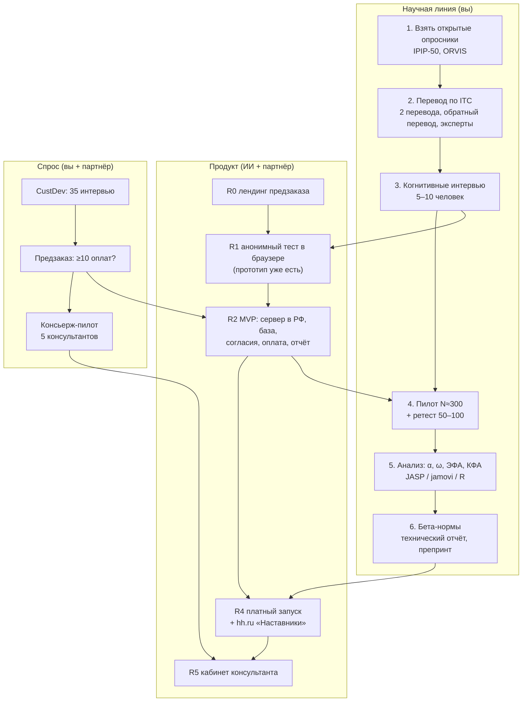

# Как собрать «Карьерный профиль»: пошаговая инструкция

Эта инструкция ведёт от пустого места до работающего продукта с данными для научной проверки. Шаги идут в том порядке, в котором их делать. У каждого шага указано, что сделать, где, какой результат получится и кто его делает: **вы**, **партнёр** или **ИИ** (Claude Code и другие агенты).

Непонятные термины объяснены в [словаре](GLOSSARY.md). Здесь они выделены *курсивом* при первом упоминании.

**Что уже готово в репозитории:**

| Файл | Что это |
|---|---|
| [`prototype/index.html`](../prototype/index.html) | Кликабельный прототип: 50 утверждений IPIP на русском (черновик), подсчёт в браузере, профиль. [Открыть](https://claude.ai/artifact/P2b5L3CCaGgbQhkWnTcGvb) |
| [`prototype/items-ipip50.csv`](../prototype/items-ipip50.csv) | Банк заданий: id, шкала, ключ, английский оригинал, черновой русский перевод |
| [`build/translation-sheet.csv`](translation-sheet.csv) | Таблица для перевода по правилам ITC: два перевода, обратный перевод, оценки экспертов. Открывается в Excel |
| [`analysis/analysis.R`](../analysis/analysis.R) | Скрипт анализа пилота: чистка, α, ω, ЭФА, КФА, бета-нормы. На учебных данных работает и без пилота. В этой среде R не установлен, поэтому скрипт не запускался |
| [`build/GLOSSARY.md`](GLOSSARY.md) | Словарь терминов простым языком |

---

## Карта проекта

**Как читать:** три линии идут параллельно. Наука даёт продукту проверенные формулировки и нормы. Продукт даёт науке поток анкет. Спрос решает, стоит ли двигаться дальше. Стрелки между линиями — зависимости: например, MVP со сбором данных (R2) запускается только после подтверждения предзаказом.

---

## Как будет выглядеть продукт глазами клиента

1. **Видео или пост** на YouTube, в VK или Telegram: «Не знаете, куда сменить профессию? Пройдите бесплатный научный профиль».
2. **Лендинг.** Что это, сколько минут, что вы получите, кто автор, почему это научно. Кнопка «Пройти бесплатно».
3. **Согласие.** Два флажка: обязательный — на обработку ответов для выдачи результата; необязательный — на использование обезличенных ответов в исследовании. Без почты и имени.
4. **Тест.** 7–10 минут: 50 утверждений о личности, затем 48 об интересах (ORVIS, 6 на шкалу). По 10 на странице, с прогрессом и одной проверкой внимания. Так выглядит [прототип](https://claude.ai/artifact/P2b5L3CCaGgbQhkWnTcGvb).
5. **Бесплатный результат.** Пять черт и восемь интересов на шкалах, короткие пояснения, карточка для сторис.
6. **Предложение.** Расширенный отчёт за 990 ₽ (3–5 направлений + план проб на 30 дней) или разбор с вами 1:1. Оплата через Robokassa или ЮKassa. Только здесь человек оставляет почту для чека и отчёта.
7. **Отчёт** в личном кабинете и в PDF.
8. **Через 30 и 90 дней** письмо: «Что вы попробовали? Сменили ли работу?». Это данные для *критериальной валидности*.

**Глазами консультанта (позже):** кабинет → «Пригласить клиента» → ссылка → клиент проходит тест → консультант видит профиль и отчёт со своим логотипом → проводит разбор.

---

## Технические слова, которые встретятся

| Слово | Простыми словами |
|---|---|
| Фронтенд | То, что человек видит в браузере: кнопки, вопросы, графики |
| Бэкенд | Программа на сервере: принимает ответы, считает, сохраняет, отправляет письма |
| База данных (PostgreSQL) | Таблицы на сервере, где хранятся ответы и оплаты |
| VPS | Арендованный компьютер в дата-центре, на котором работает сайт. Нам нужен в РФ (Timeweb, Selectel) |
| Домен | Адрес сайта, например `karierny-profil.ru` |
| API | Способ, которым программы общаются между собой: сайт ↔ сервер, сервер ↔ YandexGPT |
| Эквайринг | Приём оплаты картой или СБП (Robokassa, ЮKassa) |
| Git и GitHub | История изменений кода, как «версии документа». Репозиторий — папка проекта с этой историей |
| Деплой | Выложить новую версию на сервер |
| LLM | Языковая модель (YandexGPT, GigaChat), которая пишет связный текст отчёта по готовым баллам |
| Синтетические данные | Выдуманные ответы для разработки и тестов, чтобы ИИ-агенты не видели реальных людей |

---

## Этап 0. Подготовка (неделя 1)

**0.1. Самозанятость.** *Вы.* Скачать приложение «Мой налог» и зарегистрироваться (10 минут). Результат: вы можете принимать оплату и выдавать чеки.

**0.2. Договориться с партнёром о ролях и часах.** *Вы и партнёр.* Прочитать [отчёт 10](../agents/10-team-skills.md), раздел RACI. Записать: сколько часов в неделю даёт каждый и кто за что отвечает. Результат: короткий документ на 1 страницу.

**0.3. Аккаунты.** *Партнёр.*
- GitHub (github.com): репозиторий уже есть, добавить партнёра как коллаборатора.
- Регистратор домена (reg.ru, nic.ru): купить домен (~200–900 ₽ в год).
- Хостинг Timeweb Cloud или Selectel: пока только регистрация, сервер понадобится на неделе 9.
- Robokassa или ЮKassa для самозанятых: проверить, как они формируют чеки самозанятых в 2026 году.
- Яндекс Метрика (metrika.yandex.ru): аналитика посещений.

**0.4. Принять 12 стартовых решений.** *Вы и партнёр.* Список с рекомендациями — в [отчёте 09, §9.1](../agents/09-dev-plan.md): название, цены, платёжный сервис, хостинг, LLM.

---

## Этап 1. Где взять тест (неделя 1–2)

### 1.1. Личность: IPIP-50 (Big-Five Factor Markers)

- **Что это.** 50 утверждений, по 10 на каждую из пяти черт. Автор — Lewis Goldberg (1992). Входит в International Personality Item Pool.
- **Лицензия.** Общественное достояние: можно копировать, менять, переводить и использовать коммерчески без разрешения и оплаты. Так сказано на главной странице IPIP.
- **Где взять:**
  - главная IPIP: https://ipip.ori.org/
  - пункты IPIP-50: https://ipip.ori.org/new_ipip-50-item-scale.htm
  - ключ подсчёта: https://ipip.ori.org/newBigFive5broadKey.htm

  Если адреса сменятся (основатель сайта Lewis Goldberg умер в марте 2026 года), ищите на главной раздел «Big-Five Factor Markers».
- **Что сделать.** *ИИ, сверяет партнёр.* Пункты и ключ уже перенесены в [`items-ipip50.csv`](../prototype/items-ipip50.csv): 50 пунктов, из них 18 обратных. **Партнёр сверяет каждую строку с сайтом IPIP** (id, шкала, ключ, текст) и ставит отметку. Это первая QA-задача проекта.
- **Важно про N.** На сайте IPIP пятая шкала называется Emotional Stability (эмоциональная устойчивость), и ключи у неё обратные к нейротизму. В файле шкала записана как N (нейротизм), а в отчёте для человека показывается как «Эмоциональная устойчивость» = 100 − N. При сверке это нужно учитывать.
- **Как цитировать:** Goldberg, L. R. (1992). The development of markers for the Big-Five factor structure. *Psychological Assessment, 4*, 26–42. Плюс ссылка на ipip.ori.org.

### 1.2. Интересы: ORVIS (Oregon Vocational Interest Scales)

- **Что это.** Опросник профессиональных интересов на основе IPIP. 8 шкал: Лидерство, Организация, Альтруизм (помощь людям), Творчество, Анализ, Производство (работа руками), Приключения (риск), Эрудиция. Все пункты прямые.
- **Лицензия.** Общественное достояние, как и весь IPIP.
- **Где взять:**
  - ключ подсчёта: https://ipip.ori.org/newORVISKey.htm
  - анкета: https://ipip.ori.org/newORVISSurvey.htm
  - для сравнения переводов: русская форма на psytests.org (https://psytests.org/work/orvisen.html) и немецкая ORVIS-R (ZHAW). Их перевод — не наш источник, только ориентир.
- **Статья:** Pozzebon, J. A., Visser, B. A., Ashton, M. C., Lee, K., & Goldberg, L. R. (2010). Psychometric characteristics of a public-domain self-report measure of vocational interests: The Oregon Vocational Interest Scales. *Journal of Personality Assessment, 92*(2), 168–174.
- **Что сделать.** *Партнёр.* Скопировать пункты с сайта в новый файл `prototype/items-orvis.csv` в том же формате, что IPIP-50. В прототип ORVIS пока не встроен: пункты нужно перенести вручную со страницы-источника, чтобы не исказить формулировки. *Вы* выбираете по 6 пунктов на шкалу для короткой версии: берёте пункты с самыми высокими нагрузками из статьи 2010 года, а если их нет — самые понятные и разнообразные по содержанию.

### 1.3. Чего не брать

- MBTI, 16PF, NEO-PI, Hogan, MMPI — защищены авторским правом.
- BFI-2 и HEXACO-PI-R — только для некоммерческих исследований. BFI-2 в русской адаптации (Калугин, Щебетенко, Мишкевич и др., 2021) можно использовать в пилоте как эталон для проверки конвергентной валидности, но только с разрешения авторов и не в продукте.
- Шкалы депрессии, тревоги и выгорания (PHQ-9, GAD-7, MBI) — это данные о здоровье, красная линия ([отчёт 05](../agents/05-legal.md)).

### 1.4. Готовые данные для тренировки

Open-Source Psychometrics Project выложил ответы около миллиона человек на эти же 50 пунктов IPIP (английская версия): https://openpsychometrics.org/_rawdata/ (файл `IPIP-FFM-data-8Nov2018.zip`, внутри `data-final.csv`). *Вы* можете учиться анализу на этих данных до своего пилота: тот же скрипт, те же пункты. Лицензию самого файла уточните на сайте, прежде чем что-то публиковать на его основе.

---

## Этап 2. Как переделать тест под себя (неделя 2)

Менять можно немного, иначе потеряется связь с исследованиями оригинала. Каждое решение записывайте в файл `build/decisions.md` с датой и причиной.

**2.1. Что не меняем:** содержание пунктов (только перевод), принадлежность пунктов шкалам, ключи.

**2.2. Что адаптируем и почему:**

| Что | Решение в прототипе | Почему |
|---|---|---|
| Шкала ответов | 5 вариантов: от «Совершенно неверно» до «Совершенно верно» | Как в оригинале IPIP (Very Inaccurate … Very Accurate) |
| Порядок | Как на сайте IPIP: шкалы чередуются E, A, C, N, O | Чтобы человек не угадывал, что измеряется |
| Страницы | По 10 утверждений | Меньше усталость на телефоне |
| Проверка внимания | 1 пункт на странице 3 | Отсеять анкеты «не читая» |
| Инструкция | «Описывайте себя, каким обычно являетесь сейчас…» | Перевод и сокращение инструкции IPIP |
| Длина интересов | 6 пунктов на шкалу ORVIS вместо 12 | Время теста ≤ 10 минут. Цена — ниже надёжность, поэтому проверяем в пилоте |
| Названия шкал для человека | «Эмоциональная устойчивость» вместо «нейротизма» | Без клинического оттенка |
| Культурные детали | «parties» → «встречи и праздники» | Пример культурной адаптации, фиксируется в таблице перевода |

**2.3. Чего нельзя добавлять в MVP:** вопросы о здоровье, настроении «за последние две недели», диагнозы; вопросы о поле и возрасте без отдельного согласия. Пол и возраст нужны для норм, но их собирают как отдельный необязательный блок после согласия на исследование.

---

## Этап 3. Как перевести по правилам ITC (недели 2–5)

Полный документ: ITC Guidelines for Translating and Adapting Tests (2nd ed.), *International Journal of Testing*, 2018, DOI 10.1080/15305058.2017.1398166. Ниже упрощённая схема, которой достаточно для MVP. Вся работа ведётся в [`translation-sheet.csv`](translation-sheet.csv): откройте его в Excel и сохраните как .xlsx.

**3.1. Два независимых перевода (T1, T2).** *ИИ + 1 человек.*
- T1 уже есть: черновик ИИ в столбце «перевод 1».
- T2 делает человек с хорошим английским, не видевший T1: коллега-психолог или студент лингвистики.
- Инструкция переводчику: «переводите смысл, а не слова; язык разговорный, 7–9 класс; без двойных отрицаний».

**3.2. Согласование (T12).** *Вы.* Сравнить T1 и T2 и выбрать или сформулировать лучший вариант. Записать причину в «заметки».

**3.3. Обратный перевод (BT).** *Третий человек, не видевший оригинала.* Переводит T12 обратно на английский. *Вы* сравниваете BT с оригиналом: если смысл ушёл, ставите «да» в столбце расхождения и возвращаетесь к 3.2.

**3.4. Экспертная оценка.** *3 эксперта:* психологи или HR с опытом в тестах.
- Каждый оценивает каждый пункт по ясности (1–4) и соответствию смыслу (1–4).
- Партнёр считает CVI: доля оценок 3–4.
- Пункты с CVI < 0,78 переделываются.

**3.5. Когнитивные интервью.** *Вы, 5–10 человек из целевой аудитории* (25–45 лет, думают о смене работы).
- Человек проходит тест в [прототипе](https://claude.ai/artifact/P2b5L3CCaGgbQhkWnTcGvb) и вслух объясняет, как понял каждое утверждение.
- Вопросы: «Что для вас значит эта фраза?», «Было ли трудно выбрать ответ? Почему?», «Как бы вы сказали это своими словами?».
- Записываете проблемы в столбец «заметки когнитивных интервью».
- Особое внимание к пунктам, помеченным в CSV: A3 «insult», C4 «make a mess of things», E7 «parties».

**3.6. Финальная версия ru-0.1.** *Вы.* Заполнить столбец «финальная версия». *ИИ* переносит тексты в банк заданий и прототип. *Партнёр* сверяет перенос.

**Результат этапа:** форма ru-0.1 и таблица перевода, которая пойдёт в технический отчёт как доказательство процедуры.

---

## Этап 4. Как «скрестить» личность и интересы в рекомендации (недели 6–10)

Здесь нет готовой научной формулы. Поэтому строим прозрачные правила и честно называем их «направлениями для проверки», а не «вашей профессией».

**4.1. Основа — интересы.** Интересы предсказывают выбор сферы лучше, чем черты. ORVIS не совпадает с моделью Холланда (RIASEC), но близок к ней по смыслу:

| ORVIS | Ближайший тип RIASEC |
|---|---|
| Лидерство | Предприимчивый (E) |
| Организация | Конвенциональный (C) |
| Альтруизм | Социальный (S) |
| Творчество | Артистический (A) |
| Анализ | Исследовательский (I) |
| Производство | Реалистический (R) |
| Приключения | Реалистический (R), частично предприимчивый |
| Эрудиция | Артистический и исследовательский (гуманитарная сторона) |

Это соответствие — допущение по смыслу шкал. Его нужно проверить в пилоте корреляциями, если удастся добавить короткую RIASEC-шкалу из IPIP.

**4.2. Каталог профессий.** *Вы + ИИ.* Составить таблицу на 40–60 направлений, реальных для смены профессии в России. Для каждого:
- 2–3 ключевых интереса;
- черты, которые помогают и которые мешают;
- порог входа (обучение, сроки);
- 3–5 «проб» на 30 дней.

Источники:
- O*NET (https://www.onetonline.org/) — у каждой профессии есть профиль интересов RIASEC. База O*NET распространяется по открытой лицензии CC BY 4.0 (условия проверить на сайте).
- «Справочник профессий» Минтруда (https://spravochnik.rosmintrud.ru/).
- «Атлас новых профессий» (https://atlas100.ru/).
- Ваш опыт консультанта.

**4.3. Правило подбора (версия 1, простое и объяснимое):**
1. Берём 2–3 самых высоких интереса человека.
2. Находим направления, где эти интересы ключевые (совпадение по 2 из 3).
3. Черты не отсекают направления, а дают **пояснения**: «высокая добросовестность поможет в аналитике; если она низкая — нужна среда со структурой».
4. Показываем 3–5 направлений с аргументами «за» и «на что обратить внимание» и предлагаем пробы.

*ИИ* программирует правило. *Партнёр* проверяет на 20 выдуманных профилях, что результаты осмысленны.

**4.4. Где пишет LLM.** YandexGPT или GigaChat получает только зоны баллов и выбранные направления, а пишет связный текст по шаблону. Баллы и направления модель не выбирает. Первые 50 отчётов вы читаете сами ([отчёт 09, §5](../agents/09-dev-plan.md)).

---

## Этап 5. На какой платформе собирать

| Вариант | Что это | Плюсы | Минусы | Вердикт |
|---|---|---|---|---|
| **Свой сайт** (прототип → MVP) | HTML/JS в браузере, потом сервер на VPS в РФ | Полный контроль, данные в РФ, своя логика отчёта, дёшево | Нужна разработка — её делают ИИ-агенты | **Основной путь** |
| **formr** (https://formr.org) | Бесплатная открытая платформа исследований с обратной связью на R (Arslan, Walther & Tata, 2020) | Создана для психологических исследований, есть отчёт по результатам, анкеты задаются таблицей | Публичный сервер в Германии — не подходит из-за 152-ФЗ; свой сервер ставить сложно (Docker, R) | Хорошее **научное подспорье**, если будет помощник-программист |
| Яндекс Формы | Конструктор анкет | Бесплатно, быстро | Нет подсчёта баллов и отчёта; где хранятся данные, официально не подтверждено | Только для **анонимных** опросов CustDev |
| Анкетолог, Testograf | Платные российские конструкторы | Серверы в РФ | Платно, логика отчёта ограничена | Запасной вариант для пилота |
| Telegram-бот | Тест в чате | Привычно аудитории | Данные идут через зарубежные серверы Telegram, Telegram замедляют | Только **вход** со ссылкой на сайт |
| jsPsych, lab.js, PsyToolkit | Библиотеки и сервисы для поведенческих задач | Стандарт в науке | Для опросника не нужны; PsyToolkit хостится за рубежом | На будущее: игры на риск и решения |

### Как собирается свой сайт, по релизам

**R0, неделя 1–2 — лендинг предзаказа.** *ИИ пишет, партнёр выкладывает.* Одна страница: описание, три пакета с ценами, кнопки оплаты-ссылки Robokassa. Хостинг: любой статический без персональных данных. Персональные данные здесь собирает платёжный сервис, а не мы.

**R1, недели 5–6 — анонимный тест.** Уже есть [прототип](https://claude.ai/artifact/P2b5L3CCaGgbQhkWnTcGvb). Добавить ORVIS после перевода. Ответы никуда не уходят, всё считается в браузере. Можно выложить на домен.

**R2, недели 9–14 — MVP.**
- *ИИ-агенты* по плану [отчёта 09, §6](../agents/09-dev-plan.md):
  1. Spec пишет требования.
  2. Психометрист оформляет банк заданий и правила подсчёта.
  3. Backend делает базу и API.
  4. Frontend делает экраны.
  5. AI делает шлюз к YandexGPT или GigaChat.
  6. QA делает автотесты.
  7. Security проверяет согласия и бэкапы.
- *Стек:*
  - сайт на Astro или React;
  - сервер на Hono (TypeScript);
  - PostgreSQL;
  - всё в Docker на VPS Timeweb или Selectel в РФ;
  - бэкапы в российское S3.
- *Партнёр* запускает агентов по готовым заданиям, проверяет расчёты в Excel и следит за чек-листом безопасности.
- **До запуска R2 подать уведомление в РКН** (https://pd.rkn.gov.ru/).

**R4, неделя 20 — платный запуск.** Отчёт, оплата, письма через 30 и 90 дней, бета-нормы.

**R5, неделя 32 — кабинет консультанта.**

---

## Этап 6. Пилот: как собрать данные (недели 15–24)

**6.1. Цель.** ≥ 300 полных анкет с согласием на исследование, плюс 50–100 человек, прошедших тест повторно через 2–4 недели.

**6.2. Где набрать:**
- ваша аудитория;
- коллаборации с блогерами;
- клиенты консультантов из консьерж-пилота;
- магистранты-психологи, которым нужны данные для диплома;
- посевы — только если цена прохождения ≤ 120 ₽.

**6.3. Что добавить в пилот, кроме самого теста:**
- пол, возраст, образование, сфера работы — отдельный необязательный блок;
- 3–5 вопросов-критериев: «Насколько вы удовлетворены работой (1–7)?», «Думаете ли сменить профессию в ближайший год?»;
- по возможности короткую эталонную шкалу для конвергентной валидности (только с разрешения авторов).

**6.4. Предрегистрация.** *Вы, 1–2 часа.* До начала сбора записать на https://osf.io: гипотезы (например, «α каждой шкалы ≥ 0,70»), размер выборки, правила исключения анкет. Это бесплатно и сильно повышает доверие к результатам.

**6.5. Еженедельная проверка.** *Партнёр.* Сколько анкет, сколько исключено (провал внимания, однообразные ответы, слишком быстрые), соблюдаются ли квоты.

---

## Этап 7. Анализ: что нажимать (недели 19–24)

Можно в **JASP** (https://jasp-stats.org) или **jamovi** (https://www.jamovi.org). Обе программы бесплатные, с кнопками, без кода. Либо в **R** скриптом [`analysis/analysis.R`](../analysis/analysis.R), который делает всё ниже одной командой.

**7.1. Подготовка.**
- *Партнёр* выгружает из базы CSV без имён и почты, только ответы.
- В Excel создаёт копии обратных столбцов с формулой `=6-B2`.
- Удаляет анкеты с флагами.

**7.2. Надёжность.**
- JASP: модуль *Reliability → Unidimensional Reliability*, перенести 10 пунктов шкалы, отметить McDonald's ω и Cronbach's α, а также «If item dropped».
- jamovi: *Factor → Reliability Analysis*.
- Ориентир: ω ≥ 0,70. Пункты, после удаления которых надёжность растёт, — кандидаты на правку перевода.

**7.3. Структура (ЭФА).**
- JASP: *Factor → Exploratory Factor Analysis*, все 50 пунктов, число факторов «Parallel analysis», вращение *oblimin*.
- Смотрим, попадают ли пункты на «свои» 5 факторов с нагрузкой ≥ 0,40.

**7.4. Проверка модели (КФА).**
- JASP: *Factor → Confirmatory Factor Analysis*, задать 5 факторов по ключу.
- Смотрим CFI, TLI, RMSEA, SRMR по таблице из [словаря](GLOSSARY.md).
- Не пугайтесь, если CFI < 0,90: это типично для Big Five. Сравните с ESEM или опишите честно.

**7.5. Ретест.** Корреляция баллов первого и второго прохождения по каждой шкале. Ориентир ≥ 0,70.

**7.6. Бета-нормы.** Процентили 10, 25, 50, 75, 90 по каждой шкале. Скрипт пишет их в `norms-beta.csv`, и *ИИ* подключает их к отчёту с подписью «по пользователям сервиса, N = …».

**7.7. Кому показать.** Рецензенту-психометристу с кафедры. Предложите соавторство препринта ([отчёт 10](../agents/10-team-skills.md)).

---

## Этап 8. Технический отчёт и препринт (недели 25–32)

Структура технического отчёта v0.1 (10–20 страниц):
1. Назначение теста и чего он не делает.
2. Источники пунктов и лицензии.
3. Процедура перевода по ITC (таблица из этапа 3).
4. Выборка пилота.
5. Надёжность (α, ω, ретест).
6. Структура (ЭФА, КФА).
7. Бета-нормы.
8. Связь с критериями.
9. Ограничения.
10. Версии формы.

Препринт — сокращённая версия на PsyArXiv (https://psyarxiv.com). Это ваш главный аргумент для консультантов: «вот опубликованные данные о тесте».

---

## Аналоги и прототипы, на которые стоит посмотреть

| Что | Чем полезно | Ссылка |
|---|---|---|
| IPIP | Источник пунктов, ключей и библиографии | https://ipip.ori.org/ |
| Open-Source Psychometrics Project | Как выглядит бесплатный научный тест с открытыми данными | https://openpsychometrics.org/ |
| IPIP-NEO-120 (J. A. Johnson, 2014) | Пример бесплатного теста с подробным отчётом по 30 фасетам; на основе IPIP | статья: *Journal of Research in Personality*, 51, 78–89 |
| formr | Как учёные строят тесты с автоматической обратной связью | https://formr.org/ |
| SAPA Project | Огромное открытое онлайн-исследование личности и способностей | https://www.sapa-project.org/ |
| ORVIS-R (ZHAW, Швейцария) | Пример адаптации ORVIS с руководством для практиков | laufbahndiagnostik.zhaw.ch |
| 16Personalities, Truity | Как упаковывают результат, чтобы им делились (вирусность, карточки). Не как научный образец | 16personalities.com, truity.com |
| NeuroFrame | Конкурент в B2B-игровой оценке, **не ориентир**: заявления о валидности без независимых публикаций | — |

---

## Чек-лист готовности к сбору персональных данных

- [ ] Уведомление в РКН подано.
- [ ] Политика обработки персональных данных опубликована.
- [ ] Согласие — отдельный документ, два флажка: результат и исследование.
- [ ] Сервер и бэкапы в РФ, база зашифрована, доступ только у вас и партнёра.
- [ ] Почта хранится отдельно от ответов, связь через код.
- [ ] В LLM уходят только зоны баллов.
- [ ] Нет клинических формулировок, есть оговорка «не диагноз».
- [ ] Проверено восстановление из бэкапа.
- [ ] Партнёр сверил подсчёт на 50 наборах в Excel.

---

## Что делать на этой неделе

1. **Вы:**
   - пройти [прототип](https://claude.ai/artifact/P2b5L3CCaGgbQhkWnTcGvb) сами и дать пройти 2–3 знакомым;
   - выписать формулировки, которые звучат странно;
   - найти второго переводчика и трёх экспертов.
2. **Партнёр:**
   - сверить [`items-ipip50.csv`](../prototype/items-ipip50.csv) с сайтом IPIP;
   - скопировать пункты ORVIS в `items-orvis.csv`;
   - зарегистрировать домен.
3. **ИИ (по вашей команде):**
   - встроить ORVIS в прототип после того, как партнёр перенесёт пункты;
   - собрать лендинг предзаказа R0.
